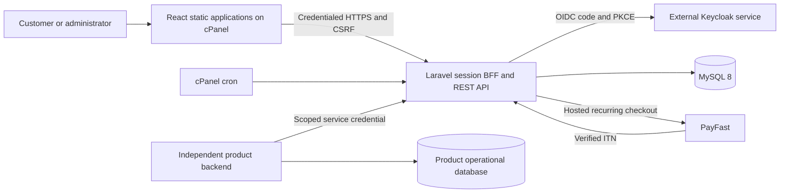

# Architecture

Mfaro Billing separates authentication, commercial authorisation and product operational data.

The SPA holds a CSRF value in memory. Authentication resides in an HTTP-only, secure, encrypted database-backed API session. Cookies are host-only; products obtain independent OIDC sessions. Access and refresh tokens are not shared through local storage, broad-domain cookies or browser query strings. The IdP owns registration, passwords, email verification, MFA and central identity sessions.

Organisation membership authorises every tenant request before a query runs. `TenantContext` checks `X-Organisation-ID` against the signed-in user, then controllers scope all tenant records with that ID. IDs in bodies are never sufficient proof of membership. Platform administrators use a separate middleware gate. Product clients use hashed expiring credentials plus explicit product and organisation scopes.

Subscription snapshots capture product plan, feature flags, usage limits, discounted subtotal, tax, currency and interval. Later catalogue edits affect future purchases only. Bundle snapshots contain all included plans, while one subscription, invoice and provider schedule represent the commercial agreement.

Financial operations use database transactions and organisation/subscription row locks. Initial purchase idempotency keys bind the organisation, request hash and persisted result. Webhook uniqueness and provider payment references prevent duplicate settlement. A pending checkout guard blocks accidental creation of another provider authorisation. A browser success return has no activation code.

Provider schedules initiate charges. The local scheduler never independently charges cards or retries provider-managed payments. Verified payment events activate/extend access. Reconciliation fetches the actual provider schedule, records differences and handles cancelled schedules; schedule state alone never manufactures a payment.

Plan changes use a durable intent before the external API call. Current access remains unchanged. The target snapshot is applied only when an eligible verified renewal has the expected amount. Uncertain provider results are marked `needs_reconciliation` and are not automatically repeated. Period-end changes intentionally avoid immediate charges/proration.

Effective entitlements are recomputed from all valid snapshots. Features combine with boolean OR. Numeric caps use the highest value; null means unlimited. Cancelling one grant source cannot remove another source's access. Service cache TTL is at most 30 seconds and never exceeds entitlement validity. No indefinite stale grants are allowed during outages.

Outbox records are committed with domain changes and delivered by cron, with bounded retries and private failure logs. Email transport has at-least-once semantics: a crash after SMTP acceptance but before commit can duplicate an email. It cannot duplicate a charge. Shared hosting uses the database cache/locks, database queue and bounded queue workers.

VPS migration preserves the application and MySQL schema. Point domain configuration to the new API, migrate private data securely, use supervised queues and one scheduler, and independently host the IdP. Product databases remain separate throughout.
